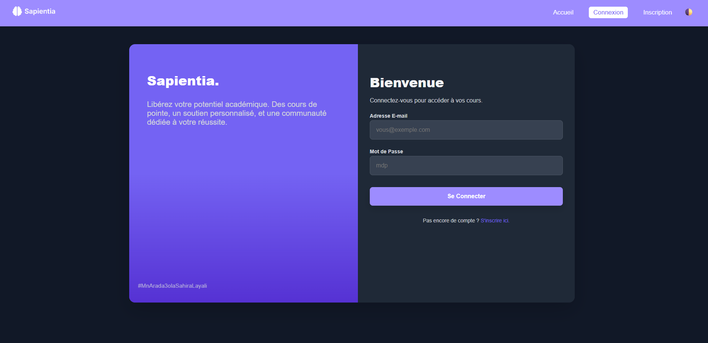
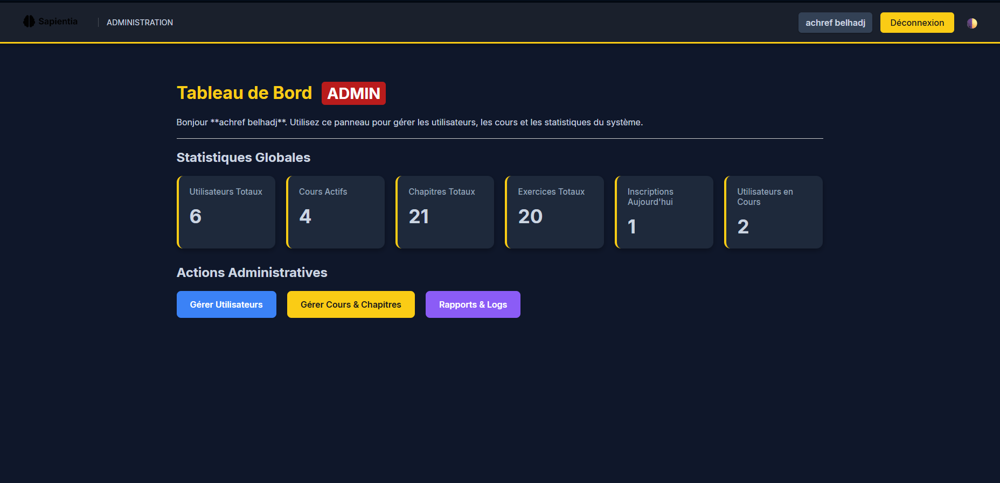
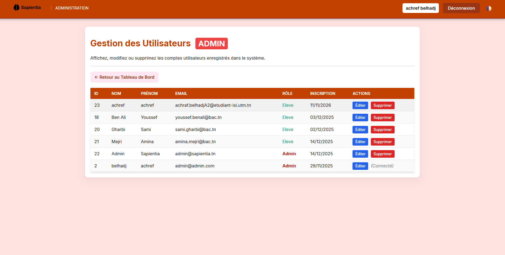
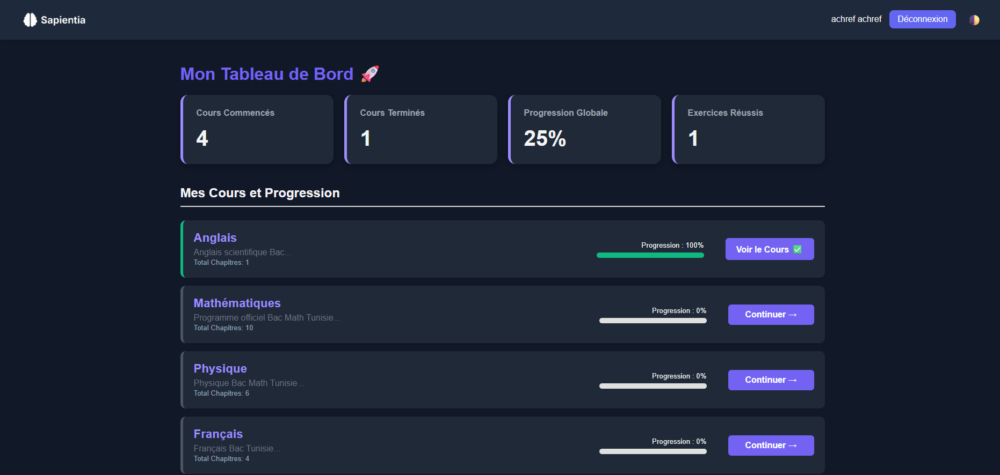

🎓 SapientiaAcademy – Educational Management Platform

Une application web éducative permettant de centraliser la gestion des cours, des chapitres, des exercices et des utilisateurs. La plateforme propose un espace administrateur pour gérer les ressources pédagogiques et un espace étudiant pour consulter les cours et pratiquer les exercices.

🚀 Fonctionnalités Clés

Gestion Complète (CRUD) : Ajout, modification, consultation et suppression des utilisateurs, cours, chapitres et exercices.

Espace Administrateur : Tableau de bord pour gérer les contenus pédagogiques, les utilisateurs, les commentaires et consulter les logs d'activité.

Espace Étudiant : Accès aux cours, consultation des chapitres et réalisation des exercices.

Gestion des Utilisateurs : Organisation des comptes et des rôles administrateur et étudiant.

Base de Données Relationnelle : Stockage et gestion des données avec MySQL.

🛠 Tech Stack

Backend : PHP

Frontend : HTML5, CSS3, JavaScript

Base de données : MySQL  XAMPP

📋 Prérequis

PHP 8.0+ (ou version compatible avec le projet)

MySQL

Apache Server

XAMPP

## 📸 Screenshots

### 🔐 Login Page

### 📊 Admin Dashboard

### 📚 users Management

### 📝 User Dashboard

